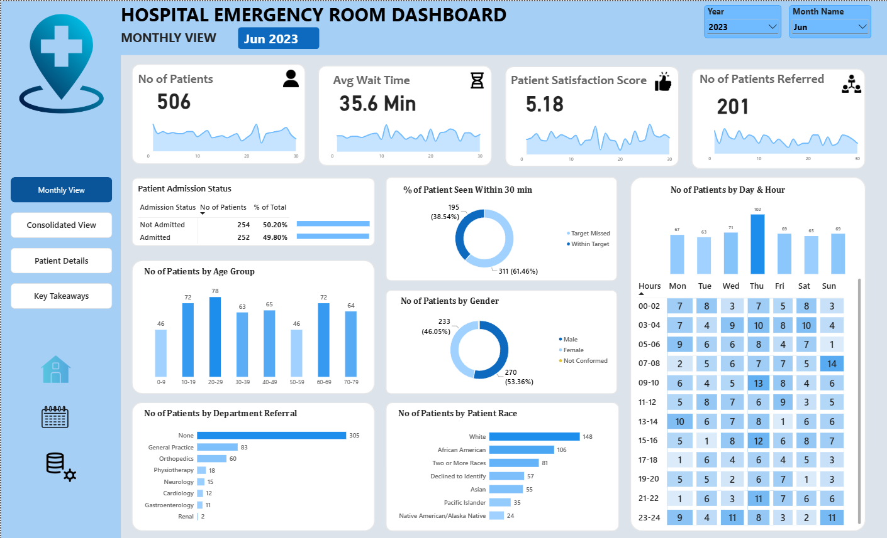
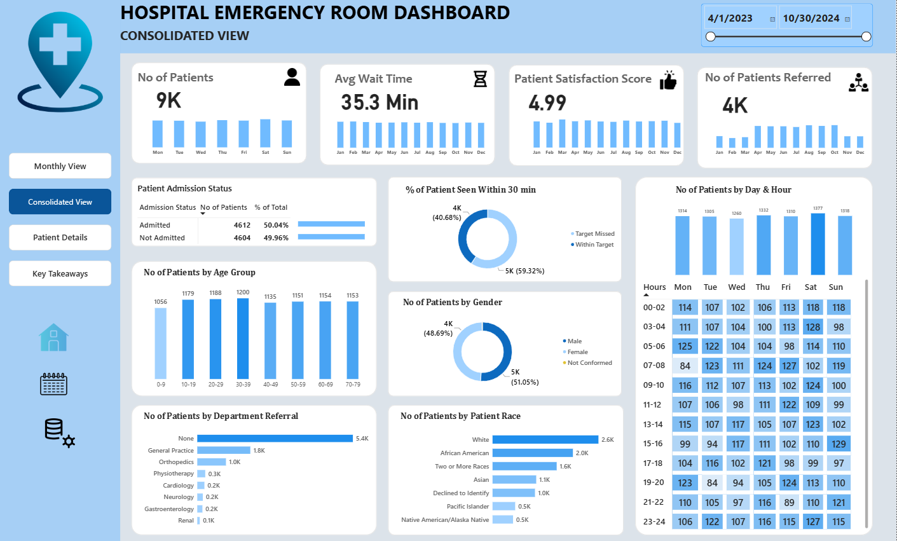
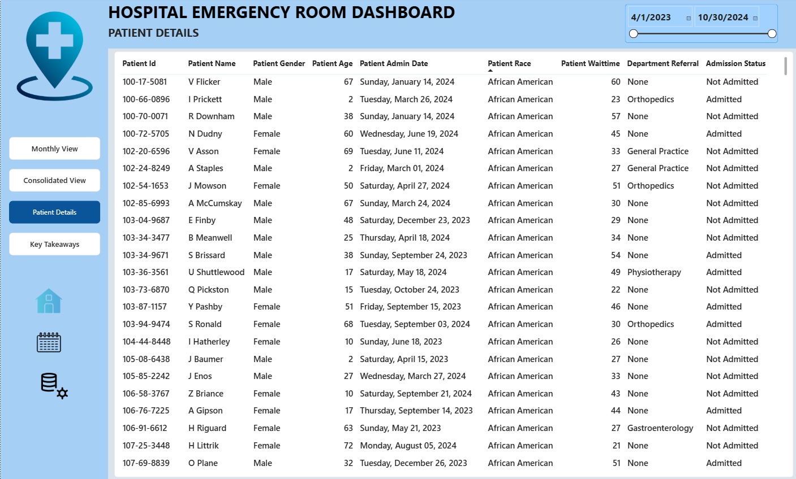
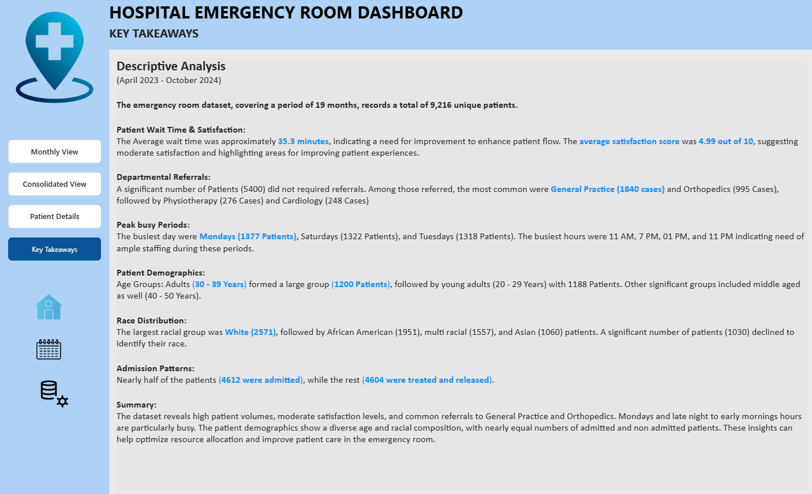

# Hospital Emergency Room Dashboard

A Power BI dashboard that analyzes emergency room (ER) patient flow, wait times, satisfaction and referrals for **April 2023 – October 2024**. It covers 9,216 patient visits and helps hospital stakeholders make data-driven decisions about staffing and patient care.



## Key Numbers

| Metric | Value |
|---|---|
| Unique patients | 9,216 |
| Average wait time | 35.3 min |
| Average satisfaction score | 4.99 / 10 |
| Patients seen within 30 minutes | 40.7% |
| Patients admitted / not admitted | 4,612 (50.04%) / 4,604 (49.96%) |
| Busiest day | Saturday (1,377 patients) |

## Dashboard Pages

1. **Monthly View** – KPIs and trends for a selected year and month, with area sparklines for each KPI.
2. **Consolidated View** – The same metrics aggregated over a selectable date range.
3. **Patient Details** – A patient-level table (ID, name, gender, age, admission date, race, wait time, department referral, admission status).
4. **Key Takeaways** – A written summary of the main findings.

### KPIs

- **Number of patients** – total ER visits
- **Average wait time** – minutes before first being seen by medical staff
- **Patient satisfaction score** – average patient rating
- **Number of patients referred** – patients sent to a specific department

### Charts

Patient admission status, patients by age group (10-year bands), department referrals, % of patients seen within 30 minutes, gender, race, and patients by day and hour (heatmap).

## Key Insights

- Average wait is 35.3 minutes and satisfaction is moderate, so there is room to improve patient flow.
- About 5,400 patients needed no referral. General Practice (1,840) and Orthopedics (995) are the most common referrals.
- Saturday is the busiest day (1,377 patients), followed by Thursday (1,332). Hourly volume is fairly even through the day.
- Ages 30–39 are the largest group (1,200), followed by ages 20–29 (1,188).
- Nearly half of patients were admitted (4,612); the rest were treated and released.

## Dataset

`data/Hospital_ER_Data.csv` has one row per ER visit (9,216 rows).

| Column | Description |
|---|---|
| Patient Id | Unique patient identifier |
| Patient Admission Date | Date and time of the ER visit |
| Patient First Inital | First initial of the patient's first name |
| Patient Last Name | Patient's last name |
| Patient Gender | Gender of the patient |
| Patient Age | Age at admission |
| Patient Race | Self-reported race or ethnicity |
| Department Referral | Department the patient was referred to (or `None`) |
| Patient Admission Flag | `TRUE` if admitted to the hospital, `FALSE` if not |
| Patient Satisfaction Score | Patient's rating of the visit |
| Patient Waittime | Minutes from arrival to first being attended |
| Patients CM | Case manager field |

A full description of each field is in [`docs/Data_Terminology.pdf`](docs/Data_Terminology.pdf).

## Project Steps

1. Requirement gathering / business requirements
2. Data walkthrough
3. Data connection
4. Data cleaning / quality check
5. Data modeling
6. Data processing
7. DAX calculations
8. Dashboard layouting
9. Charts development and formatting
10. Dashboard / report development
11. Insights generation

## Tools

- Power BI Desktop
- DAX

## Repository Structure

```
hospital-er-dashboard/
├── README.md
├── data/
│   └── Hospital_ER_Data.csv
├── dashboard/
│   └── Hospital_Dashbord.pbix
├── docs/
│   └── Data_Terminology.pdf
├── presentation/
│   └── ER_Dashboard.pptx
└── images/
    ├── monthly.png
    ├── consolidated.png
    ├── details.png
    └── takeaways.png
```

## How to Open

1. Install [Power BI Desktop](https://powerbi.microsoft.com/desktop/) (Windows).
2. Download `dashboard/Hospital_Dashbord.pbix` and open it.
3. If Power BI cannot find the data, go to **Home → Transform data → Data source settings** and point it to `data/Hospital_ER_Data.csv`.

## Screenshots

### Consolidated View


### Patient Details


### Key Takeaways

